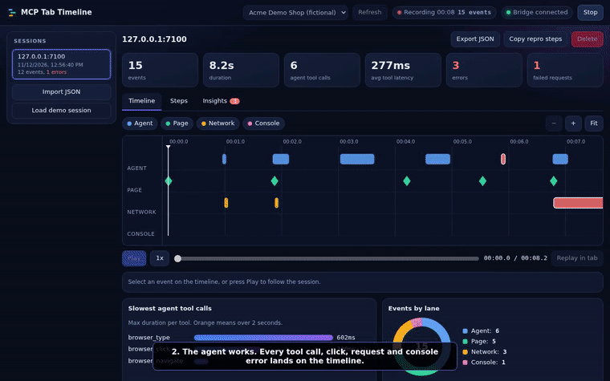

# MCP Tab Timeline

Record what a coding agent does in a browser tab, then replay it as a visual timeline.

Agent tool calls, page clicks, network requests and console errors land on one shared clock. When a run goes wrong you see where, with a screenshot, instead of scrolling a transcript.



**Live demo (fictional data, runs in the browser):** https://delevski.github.io/mcp-tab-timeline/

## What you get

- **One timeline, four lanes.** Agent tool calls, page actions, network, console. Zoom, filter, click any marker.
- **Replay.** Play the session back with a moving playhead and screenshots. Or replay the recorded clicks and typing in the real tab.
- **Insights.** Failed requests, console errors, slow tool calls, retry loops (same element clicked 3 times) and agent actions with no page reaction.
- **Works with any MCP server.** `mcp-tap` is a stdio proxy you put in front of your browser MCP. It forwards everything unchanged and reports each `tools/call` to the local bridge.
- **Local and free.** Nothing leaves your machine. No account, no API key, no card.
- **Safe by default.** Password and card-like fields are masked in recordings. Recordings stay in the extension's local storage until you export them.

## Install (about 2 minutes)

### 1. Load the extension

1. Clone this repo: `git clone https://github.com/delevski/mcp-tab-timeline`
2. Open `chrome://extensions`, turn on **Developer mode**.
3. Click **Load unpacked** and pick the `extension/` folder.
4. Click the extension icon. The timeline opens in the side panel.

Needs Chrome 116 or newer.

### 2. (Optional) Capture agent tool calls

Without this step you still get page actions, network and console. To add the agent lane, run the bridge and wrap your MCP server:

```bash
# terminal 1
node bridge/server.mjs

# in your MCP client config, put mcp-tap in front of the server
# before:  npx @playwright/mcp@latest
# after:   node /path/to/mcp-tab-timeline/bridge/mcp-tap.mjs -- npx @playwright/mcp@latest
```

Claude Code example:

```bash
claude mcp add browser -- node /path/to/mcp-tab-timeline/bridge/mcp-tap.mjs -- npx @playwright/mcp@latest
```

The header pill shows **Bridge connected** when it is reachable. Bridge and proxy have no dependencies, only Node 18+.

### 3. Record

1. Pick the tab the agent works in and press **Record tab**.
2. Let the agent work.
3. Press **Stop**. Open **Insights** for the problems found, or **Steps** for a table you can copy as repro steps.

## Try it without installing anything

The live demo above runs the same UI on a fictional checkout session. Press **Simulate live recording** to watch events stream in. `npm run e2e` runs the real extension, bridge and proxy against a fictional shop (needs Chrome and `npm install`).

## How it works

```
 coding agent --MCP--> mcp-tap --MCP--> browser MCP server --> Chrome tab
                         |                                        |
                    tool calls                       clicks, input, requests, console
                         v                                        v
                   local bridge  ----polled by---->  extension service worker
                                                              |
                                                     timeline UI (side panel)
```

- `extension/` Manifest V3 extension: content script, page hook, service worker, timeline UI.
- `bridge/server.mjs` local HTTP bridge on `127.0.0.1:7077`.
- `bridge/mcp-tap.mjs` MCP stdio proxy.
- `examples/` fictional demo shop and a tiny MCP server used by the e2e check.
- `docs/` the UI as a static site (GitHub Pages), built by `npm run build:demo`.

## Privacy

- The bridge listens on localhost only.
- Typed values are stored, except fields that look like passwords, cards or secrets, which are stored as dots. Review an export before sharing it.
- Screenshots are taken only while recording, at most one per click or navigation, up to 60 per session.

## Develop

```bash
npm install        # only needed for the e2e script
npm test           # bridge and insights tests
npm run e2e        # full run with a real Chrome
```

## Limits

- Records one tab at a time. Only http, https and file pages.
- Agent calls are matched to page events by time, not by id.
- Replay in tab uses recorded CSS selectors. Pages that change a lot between runs can fail with "element not found".

## License

MIT
